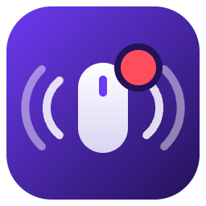

<p align="center">
  
</p>

<h1 align="center">MacNotify</h1>

<p align="center">
  <b>Feel your Mac notifications.</b><br/>
  A Logitech Actions SDK plugin that plays haptic feedback on the MX Master 4 mouse
  the moment a macOS notification banner appears — with per-app vibration patterns.
</p>

## Features

- ⚡ **Real-time** — detects notification banners in ~100 ms by streaming the macOS unified log (no polling delay)
- 🎛️ **15 vibration patterns** — pick your favorite from a dropdown in Logi Options+, with instant haptic preview
- 📱 **Per-app patterns** — give Slack a `knock`, Calendar a `jingle`, or mute noisy apps entirely; tell notifications apart without looking at the screen
- 🔕 **Focus-mode aware** — only vibrates when a banner is actually presented, so Do Not Disturb stays silent
- 🎚️ **One-button mute** — bind the On/Off toggle to a mouse button for meetings
- 🔒 **Private by design** — notification content is never read, collected, or stored; only the fact that a banner appeared (and the sending app's bundle id) is used

## Requirements

- macOS
- Logitech **MX Master 4** (the only mouse with a haptic motor)
- [Logi Options+](https://www.logitech.com/software/logi-options-plus.html) 1.95 or later

## Installation

Download `MacNotify_x_x.lplug4` from [Releases](../../releases) and double-click it,
or install via the Logi Plugin Tool:

```
logiplugintool install MacNotify_1_0.lplug4
```

Then in **Logi Options+ → MX Master 4 → buttons**, you'll find the MacNotify actions:

| Action | What it does |
|---|---|
| **Haptic Pattern** | Choose the global vibration pattern (with live preview) |
| **Per-App Haptic Pattern** | Override the pattern for a specific app, or mute it |
| **Notification Haptics On/Off** | Toggle all notification haptics |
| **Test Haptic** | Play the current pattern once |

### Full Disk Access (optional fallback)

MacNotify normally needs no special permissions. If the real-time log stream is
unavailable, it falls back to reading the Notification Center database, which requires
granting **Full Disk Access** to `LogiPluginService` in
System Settings → Privacy & Security.

## Building from source

Requires the [.NET 8 SDK](https://dotnet.microsoft.com/download/dotnet/8.0) and Logi Options+.

```
dotnet tool install --global LogiPluginTool
dotnet build            # registers a dev link with the Logi Plugin Service
```

Package for distribution:

```
dotnet build -c Release
logiplugintool pack ./bin/Release/ ./MacNotify_1_0.lplug4
logiplugintool verify ./MacNotify_1_0.lplug4
```

## How it works

MacNotify streams the unified log of `usernoted` (the macOS notification daemon) and
triggers a haptic event through the [Logi Actions SDK](https://logitech.github.io/actions-sdk-docs/)
whenever a banner is presented. Each of the 15 SDK waveforms is registered as a plugin
event, so the pattern can be switched at runtime — globally or per app.

## License

[MIT](LICENSE)
